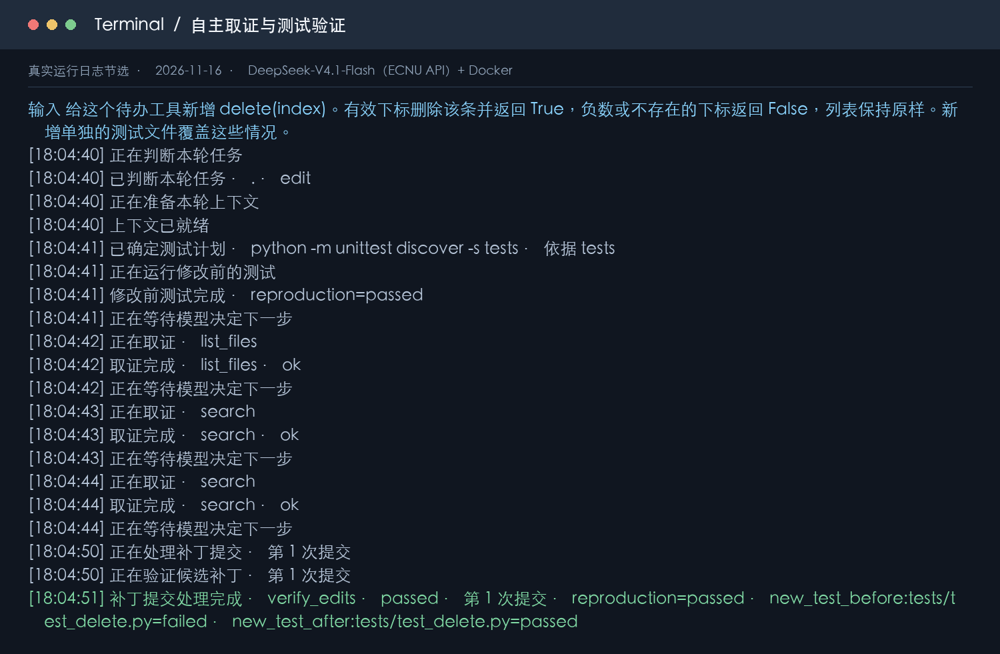
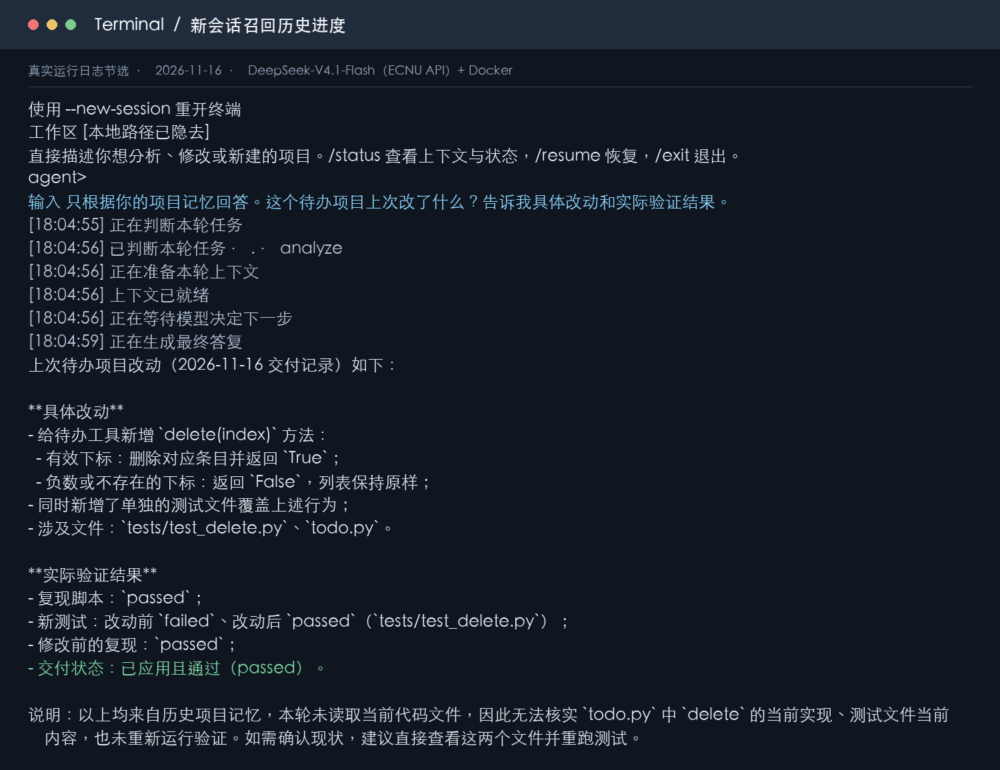
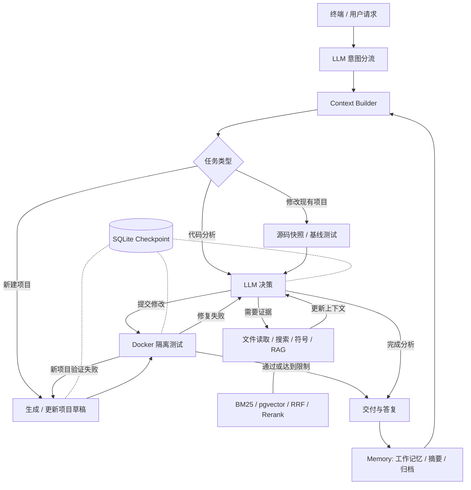

# Context-Aware Coding Agent

> 面向 Python 代码库的终端编程助手。通过源码检索、长程记忆、上下文管理和沙箱验证，支持从自然语言任务到经过测试的代码修改。


[运行演示](#运行演示) · [核心功能](#核心功能) · [系统架构](#系统架构) · [实验结果](#实验结果) · [快速开始](#快速开始) · [技术文档](#技术文档)

## 项目介绍

普通代码问答往往依赖用户手动提供源码，也无法知道生成的修改是否真正通过测试。本项目让模型在受控的工作流中自主获取仓库证据、提交代码修改、读取测试反馈，并在后续会话中继续同一个项目的任务。

使用自然语言即可发起任务，例如：

```text
> 检查这个项目的目录结构，说明主要模块的作用。
> 修复查询包含首尾空格时无法正确匹配的问题。
> 新建一个 Python 待办事项工具，包含 README 和单元测试。
> 上次这个项目修改到哪里了？
```

终端会显示任务分流、上下文准备、检索、工具执行、测试和答复进度。`/status` 查看状态和上下文预算，`/resume` 继续中断的回合，`/exit` 退出。

## 运行演示

**自主取证与测试验证**：接收新增待办删除功能的请求后，模型自主调用文件工具、提交精确编辑并运行测试。新增测试在修改前失败、修改后通过。



**跨会话记忆**：退出终端并创建新会话后，Agent 从历史项目记忆中恢复之前的修改内容及验证结果，同时说明本轮未重新检查源码。



两幅图为 2026-11-16 使用 DeepSeek-V4.1-Flash 与 Docker 的真实运行日志节选，本地绝对路径已隐藏。

## 核心功能

| 模块 | 实现能力 |
| --- | --- |
| **Agent 编排** | LangGraph 管理状态和条件分支，LLM 自主选择取证工具与参数，根据工具反馈继续决策；自然语言分流到分析、修改或项目生成。 |
| **代码与文档 RAG** | Python AST / `symtable` 源码结构分析，保留函数、类、引用、路径和原文行号；Markdown 按标题、段落、句子边界切分；支持父子块合并、BM25、向量检索、RRF、查询增强和重排。 |
| **增量向量索引** | PostgreSQL + pgvector 共享嵌入基础设施。内容哈希复用向量，变更只更新相关块；持久化任务、租约、重试和版本核对保证索引可恢复。 |
| **长程记忆** | Working、Summary、Archive 三层记忆；支持事实有效时间、历史版本、摘要失效、BM25 / 向量检索和 RRF 融合。项目进度按工作区隔离，长期用户偏好可跨会话复用。 |
| **上下文工程** | Gather → Select → Structure → Compress：汇集历史、记忆、源码和工具证据，按预算筛选和组织；终端在预计输入达到预算的 80% 时压缩较早对话。 |
| **测试与交付** | Git 生成标准 diff；Docker 在隔离副本中执行测试，失败结果反馈给模型。测试通过后才交付，支持冲突检查与独立 Git worktree。 |
| **会话恢复** | SQLite 保存 LangGraph 执行检查点，JSON 保存会话入口和历史；中断后恢复未完成步骤，并保留可追踪的工具与验证记录。 |

## 系统架构



LangGraph 负责规定允许的状态转换；模型决定具体工具、输入和何时需要继续取证。程序负责校验参数、控制次数、运行测试和交付结果。这样既能适应不同仓库，也能将关键执行边界保持在确定性代码中。

### 技术取舍

| 技术 | 选择原因 |
| --- | --- |
| LangGraph + 自研检索及上下文组件 | 使用成熟的有状态编排，同时保留对切块、融合、预算、记忆生命周期和评测口径的直接控制。 |
| AST + `symtable` + 父子块 | 减少固定长度切块对函数结构的破坏；小块负责精确定位，父块按命中情况和预算补充源码。 |
| PostgreSQL + pgvector | 将模型配置、向量缓存、块状态与索引任务放在一个事务体系内，便于处理增量更新和版本一致性。 |
| BM25、向量、RRF 与可选重排 | 代码中的标识符匹配与自然语言语义召回各有优势，按任务对照选择；不默认认为增加检索路数或重排一定更好。 |
| JSON 业务记忆 + SQLite 检查点 | 将轻量的长期记忆与工作流执行状态分离，便于本地查看、恢复和测试。 |
| Git + Docker | 通过确定性文本替换和 Git 构造补丁，使用重复可控的测试环境检查实际修改行为。 |

## 实验结果

使用公开数据评价代码检索、文档检索与代码修复。

对话及大模型重排实验使用 **DeepSeek-V4.1-Flash**

### 1. RAG 检索

| 数据集 | 检索策略 | 命中率 | nDCG@10 | P95 |
| --- | --- | ---: | ---: | ---: |
| RepoQA Python（100 题） | BM25 | Hit@5 29% | — | 0.149 秒 |
| RepoQA Python（100 题） | 纯向量检索 | Hit@5 **73%** | — | 0.338 秒 |
| BEIR SciFact（300 个查询） | BM25 | Hit@10 80.3% | — | 0.136 秒 |
| BEIR SciFact（300 个查询） | BM25 + 向量 + RRF | Hit@10 85.7% | 0.700 | 2.12 秒 |
| BEIR SciFact（300 个查询） | RRF + DeepSeek-V4.1-Flash Top 20 重排 | Hit@10 **88.7%** | **0.785** | 6.72 秒 |

代码检索从 BM25 切换到纯向量召回，Hit@5 提升 44 个百分点。普通文档检索通过 RRF 融合提高召回，再由大模型对前 20 个候选块重排，进一步提高命中率和排序质量，同时增加查询延迟。

RepoQA 的 Hit@5 指前五个返回块中存在与标注函数位于同一文件且原文区间重叠的块。SciFact 按文档 ID 去重，并使用官方相关性标签计算指标。
### 2. 代码修复

| 数据集 | 对照设置 | 通过官方测试 |
| --- | --- | ---: |
| HumanEvalFix Python，全量 164 题 | 改进版 Agent | **154/164（93.9%）** |
| BugsInPy `youtube-dl`，43 题 | 旧版 → 新版 Agent | 14/43 → **23/43**（32.6% → 53.5%） |
| BugsInPy `youtube-dl`，同批 43 题 | 同模型单次直答 | 8/43（18.6%） |


## 快速开始

环境要求：Python 3.10+；真实修复和项目生成需要 Git、Docker 及已下载的测试镜像；向量检索另外需要 PostgreSQL + pgvector 和嵌入服务。

### 1. 离线体验

从仓库根目录执行：

```bash
python3 -m venv .venv
source .venv/bin/activate
python -m pip install -e .

python run.py demo --mode issue
python run.py example memory-rag
```

### 2. 使用真实模型与交互终端

先执行 `cp .env.example .env`（已有配置时无需重复复制），在 `.env` 填写 `LLM_BASE_URL`、`LLM_MODEL` 和 `LLM_API_KEY`，使用兼容 Chat Completions 的接口。复现 ECNU 上的 DeepSeek-V4.1-Flash 实验时，设置 `LLM_MODEL=ecnu-max`。配置完成后启动 Docker 并运行：

```bash
docker pull python:3.12-slim
mkdir -p runtime/terminal-workspace
python run.py terminal --workspace runtime/terminal-workspace
```

### 3. 启用向量检索

填写 `.env` 中的数据库连接、PostgreSQL 口令和 `EMBEDDING_*` 配置，确保嵌入维度与所选模型一致，随后执行：

```bash
python -m pip install -e '.[embedding,benchmark]'
docker compose up -d postgres
python scripts/check_postgres.py
python run.py terminal --workspace runtime/terminal-workspace --retrieval vector
```

将 `--retrieval vector` 改为 `--retrieval hybrid` 可启用 BM25 与向量的 RRF 混合源码检索。

### 4. 运行公开检索评测与本地检查

分别下载 [RepoQA 官方 JSON.GZ](https://github.com/evalplus/repoqa_release/releases/tag/2024-06-23) 和 [BEIR SciFact ZIP](https://public.ukp.informatik.tu-darmstadt.de/thakur/BEIR/datasets/scifact.zip)，替换下面的数据路径。

```bash
python run.py bench-rag /path/to/repoqa-2024-06-23.json.gz --k 5
python run.py bench-docs /path/to/scifact.zip --k 10

python run.py check retrieval
python run.py check agent
python run.py check repair
```

增加 `--embedding`、`--rerank`、`--rerank-candidates` 等参数进行召回与重排消融；源码覆盖增加 `--source-coverage`。真实向量、重排和查询增强实验需要配置相应 API。完整参数见 `python run.py bench-rag --help`、`python run.py bench-docs --help`。

## 仓库结构

```text
context-engineering-lab/
├── context_lab/
│   ├── agents/          # LangGraph 状态图、意图路由、会话工作流
│   ├── context/         # 上下文装配与预算管理
│   ├── rag/             # 结构切块、召回、扩展、重排、检索评测
│   ├── embeddings/      # HTTP 嵌入、pgvector 存储、增量任务
│   ├── memory/          # 分层记忆、事实时效、检索与留存
│   ├── tools/           # 文件、符号、RAG、Docker 测试与交付
│   ├── storage/         # 持久化与环境配置读取
│   └── terminal_ui.py   # 多轮终端、进度展示与答复流
├── examples/           # 离线示例和教学仓库
├── tests/              # 组件与工作流测试
├── scripts/            # 数据库和嵌入验收脚本
├── docs/               # 架构、技术取舍和实验复盘
├── compose.yaml        # PostgreSQL + pgvector
└── run.py              # 命令行入口
```


## 项目边界与来源

项目最初参考 [Datawhale Hello-Agents 第九章](https://github.com/datawhalechina/hello-agents/tree/main/docs/chapter9) 的上下文工程思路，后续实现了增量向量索引、结构感知 RAG、事实记忆及终端修复工作流。评测数据来自 [RepoQA](https://github.com/evalplus/repoqa)、[BEIR](https://github.com/beir-cellar/beir)、[HumanEvalPack / HumanEvalFix](https://github.com/bigcode-project/octopack) 和 [BugsInPy](https://github.com/soarsmu/BugsInPy)。
